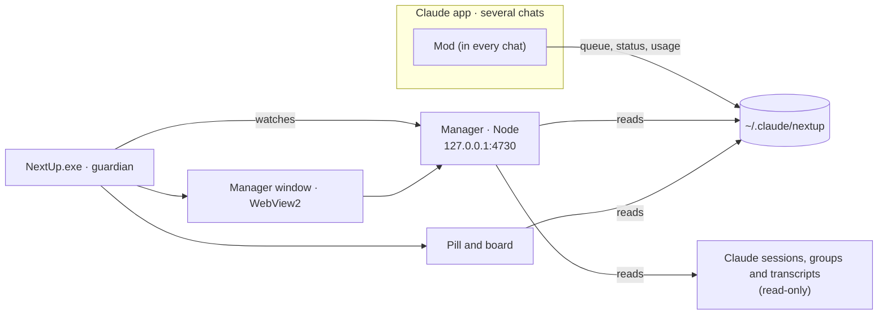

<p align="center">
  
</p>

<h1 align="center">NextUp</h1>

<p align="center">
  <b>Stop hopping from chat to chat.</b><br>
  See, in one place, what is waiting for you, what is working and which projects you are letting slip in your Claude Code chats.
</p>

<p align="center">
  
  
  
  
  
  
</p>

> **Language:** the app's interface and the technical reference ([`docs/referencia.md`](docs/referencia.md)) are in
> European Portuguese. This README is in English, and it gives the Portuguese name of every button and tab you
> will see (for example **Dispensar** = dismiss).

---

## Why

When you work with five or six Claude Code chats at the same time, the hard part is no longer asking: it is
knowing **whom to answer first**. Every chat that finishes sits there quietly waiting for you, and you go
through them one by one to find out which was which.

NextUp answers three questions without opening a single chat:

1. **What is waiting for me, and what is most urgent?**
2. **What is working, and how far along is it?**
3. **Which projects am I letting slip?**

## What you get

| | |
|---|---|
| **AI-ranked queue** | At the end of each turn, a small model reads the request and the reply and classifies the chat: importance, type (approval, decision, review or information), effort and whether it unblocks the chat. It also writes a card with what you asked, what was done and what needs you. The queue is ordered by this, not by arrival time. |
| **Pill** | A discreet pill in the corner of the screen: how many chats are waiting and how many are working. Hover over it to open a board with the queue and the progress of each job. It never steals focus from Claude. |
| **Chat manager** | A window of its own with the **Painel** (dashboard: waiting for you, working, recent), the **Projetos** (projects), the **Consumo** (usage) tab and the tree of your Claude groups. |
| **Menu key** | The keyboard's context-menu key (`VK_APPS`): one tap opens and closes the manager; holding it for about 1 s shows or hides the pill. No mouse, no hunting for windows. |
| **Built not to die** | A guardian restarts the app if it crashes, watches the manager's server and survives closed terminals and reboots. |

### Projects: so nothing gets forgotten

When you open a folder, the manager shows one tile per project, text only: what is **done**, what is **left**
(by priority) and the **pace**: active today, cooling down, stopped, or **forgotten** (stopped for 7 days or
more and with things still to do). Filters, sorting and search sit on top; the detail opens only when you
click a tile. The **×** dismisses a project until there is news in it.

### Usage: how much you are really using

A token history rebuilt from your transcripts, the equivalent API cost in dollars and euros, active and
passive hours of use, the week and the 5-hour session with a forecast of when they run out at the current
pace, and peak hours.

- **Limits** (week and 5-hour session) are read from the Claude app itself, for the account you are signed
  in with, so they work whatever plan you have.
- **Savings versus your subscription:** NextUp does not detect your plan. You type what you pay per month in
  the Consumo tab, and the savings are the API-equivalent cost minus that amount.

### Dismiss without guilt

**Dispensar** (dismiss) hides a chat until its next turn; chats archived in the app never count. The queue
shows only what needs you.

## Screenshots

Every image uses 100 % fictional demo data (the projects, chats and figures are invented), so none of them
shows real work. How they are generated is in the [technical reference](docs/referencia.md#dados-de-demonstração-e-capturas).

### Dashboard

What is waiting for you, in the AI's order, and what is working, with the progress of each chat.


### A chat's card

Click a chat to open its card: what you asked, what was done, what needs you, the importance, the type of
wait and the timeline.


### Projects

When you open a folder, one tile per project: what is done, what is left (by priority) and the pace. The
Blog Maré project has been stopped for 9 days with things still to do, so it shows as forgotten.


Click a tile to open the detail: everything that is left by priority, what is done, the pace over the last
days and the chats of the group.


### Usage

API-equivalent cost against the subscription, active and passive hours, cost per day and the limit forecast.


### Pill and board

The pill sits in the corner of the screen; hover over it to open the board with the queue and the progress of
each job.

<p>
  
  &nbsp;&nbsp;
  
</p>

## How it works



- The **mod** runs inside every Claude Code chat and writes its state to `%USERPROFILE%\.claude\nextup\`.
- The **manager** is a local server (Node, no dependencies) that joins that state with the Claude app's
  sessions, which it **only reads**.
- **`NextUp.exe`** shows the pill, opens the manager in a window and watches over everything.

## Requirements

| | |
|---|---|
| System | Windows 11 (64-bit) |
| Claude app | Claude app for Windows with the **Code** tab (tested with Claude Code 2.1.309) |
| .NET | [.NET 9 Desktop Runtime](https://dotnet.microsoft.com/download/dotnet/9.0) (x64) |
| Node.js | [Node.js](https://nodejs.org/) on the `PATH` (tested with version 24) |
| WebView2 | The runtime already ships with Windows 11 |

## Installation

1. **Download** `NextUp-1.1.1-win-x64.zip` from the [Releases](../../releases) page and extract it to a folder
   that will stay put, for example `C:\NextUp`. The mod is loaded from that folder, so do not delete or move it
   afterwards.
   > `NextUp.exe` is not signed: Windows may warn that it does not recognise it. Before extracting, unblock the
   > zip (`Unblock-File .\NextUp-1.1.1-win-x64.zip`) or, in the warning, choose *More info → Run anyway*.

2. **Connect the mod to Claude Code.** In `~/.claude/settings.json` (make a copy first), add to the `env` block:

   ```json
   {
     "env": {
       "CLAUDE_CODE_PLUGIN_DIRS": "C:\\NextUp\\mod",
       "CLAUDE_CODE_PLUGIN_DIR_WATCH": "1"
     }
   }
   ```

   `CLAUDE_CODE_PLUGIN_DIR_WATCH=1` reloads the mod whenever its code changes.

3. **Start NextUp:** run `C:\NextUp\NextUp.exe`. The pill appears in the bottom-right corner.

4. **Start with Windows** (optional): `C:\NextUp\NextUp.exe --arranque on`, or switch it on in the tray icon's menu.

5. **Open a new chat** in Claude Code. The mod only loads in chats you open from here on; the ones that were
   already open are left out. When that chat finishes its first turn, it shows up in the queue.

6. **Orchestrator** (optional): a chat just for status reports on all your chats and for sending messages,
   always with your confirmation.
   - Copy `C:\NextUp\skills\orquestrar` to `~/.claude/skills/`.
   - Open a chat for it and tell NextUp which one it is: create `%USERPROFILE%\.claude\nextup\orquestrador.json`
     with `{"local":"local_…"}`, where `local_…` is the name of that chat's file in
     `%APPDATA%\Claude\claude-code-sessions\<account>\<organisation>\`. The orchestrator stays out of the queue.

### Upgrading from Fila (1.0.4 or earlier)

NextUp is the new name of Fila (November 2026). Quit Fila first (tray icon, or `Fila.exe --sair`), extract the new zip and point
`CLAUDE_CODE_PLUGIN_DIRS` at its `mod` folder. On its first start NextUp moves your data by itself:
`%USERPROFILE%\.claude\fila-atencao` to `%USERPROFILE%\.claude\nextup`, `%LOCALAPPDATA%\Fila` to `%LOCALAPPDATA%\NextUp`, and the
Windows start-up shortcut. Chats that were already open keep the old mod until you reopen them. Then delete the old `Fila` folder.

## Daily use

| You want to | How |
|---|---|
| Open or close the manager | Menu key: one tap |
| Show or hide the pill | Menu key: hold for about 1 s |
| See the queue without opening anything | Hover over the pill |
| Search chats, groups and actions | `Ctrl` `K` in the manager |
| New chat in a folder | `N` in the manager |
| Open the orchestrator chat | `O` in the manager |
| Close the card or the dialog | `Esc` |
| Take a chat out of the queue | **Dispensar** on the chat's card |

> No menu key on your keyboard? The tray icon does the same: one click opens the manager.

## Privacy and security

- **Everything is local.** The server only listens on `127.0.0.1`, and requests that change anything require a
  local origin.
- **It only reads Claude's data** (sessions, groups, transcripts). It does not change chats, groups or
  sessions. The folders and marks you create belong to the manager alone.
- **Transcripts:** only counts, times and the end of the last request and reply are shown; nothing leaves
  your machine.
- **Secrets:** `claude_desktop_config.json` is read only for the groups; the MCP servers and their keys never
  reach the API (there is a test for it).
- **Network.** The manager asks the ECB (`ecb.europa.eu`) for the exchange rate to convert the cost to euros,
  and the manager page loads its typefaces from Fontshare and Google Fonts. These are read-only requests:
  they carry no data from your chats.
- **The classification uses your account:** every turn spends a small part of your limit on a small Claude
  model (Haiku).

## Known limitations

- Windows 11 only.
- There is no button to send messages to chats from the manager: Claude's auto mode refuses sends that come
  from a mod. To message a chat, ask the orchestrator.
- The AI's **done** and **left** lists only reach a chat on the turn after the mod loads; until then the
  manager uses the task list and the app's summary.
- Chats opened before a mod update keep the old mod until they finish a turn.
- A chat closed mid-turn can keep showing as "working" (for up to 3 h); **Dispensar** removes it.
- Peak hours have no official rule in force: they are an estimate from your own readings.
- `NextUp.exe` is not signed.

## Troubleshooting

| Symptom | What to do |
|---|---|
| The pill does not appear | Look for the icon in the tray; if it is not there, run `NextUp.exe` and check `%USERPROFILE%\.claude\nextup\app.log`. |
| The manager opens empty or does not open | Check that Node is installed (`node --version`). In the tray icon, choose *Reiniciar o servidor do gestor* (restart the manager's server); errors go to `gestor-erros.log`. |
| The dashboard shows no chats | The mod only loads in **new** chats once `settings.json` is set up. Open a new chat and let it finish a turn. |
| Port 4730 is taken | The manager uses the next free one; the app reads it from `gestor.json`. |
| The menu key does nothing | Another program may be using the keyboard hook; the tray icon still opens the manager. |
| A chat stays "working" forever | **Dispensar** on the chat's card. |

## For developers

- [`docs/referencia.md`](docs/referencia.md) (Portuguese): every part in detail, the data on disk, the manager's
  API, the environment variables and the command line.
- [`CONTRIBUTING.md`](CONTRIBUTING.md): how to contribute.

```powershell
node --test "gestor/test/*.test.mjs"                                          # manager tests
$C = (Get-ChildItem "$env:APPDATA\Claude\claude-code\*\*\claude.exe" | Sort-Object LastWriteTime)[-1].FullName
& $C plugin test mod                                                          # mod tests
powershell -NoProfile -ExecutionPolicy Bypass -File app\publicar.ps1 -Arrancar  # build, publish and start
```

## Uninstall

1. Remove the two `CLAUDE_CODE_PLUGIN_*` lines from the `env` block of `~/.claude/settings.json`.
2. Quit NextUp from the tray icon (or `NextUp.exe --sair`) and switch off the autostart (`NextUp.exe --arranque off`).
3. Optional: delete `%USERPROFILE%\.claude\nextup\` (queue, organisation, usage, history, messages and
   logs) and `%LOCALAPPDATA%\NextUp\` (the WebView2 profile).

## Contributing

Help is welcome, by pull request from a fork: read [`CONTRIBUTING.md`](CONTRIBUTING.md) (how to run the tests
and what not to put in the sample data). For a bug or an idea, open an issue. For a vulnerability, see
[`SECURITY.md`](SECURITY.md). Only the project owner can write to `master`.

## License

[MIT](LICENSE) © 2026 António Sousa. `NextUp.exe` ships with the *Microsoft Edge WebView2 SDK*
(`Microsoft.Web.WebView2`), which has its own license.

Version **1.1.1**.
